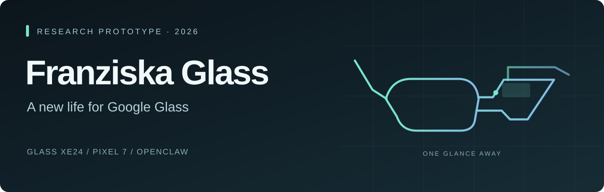
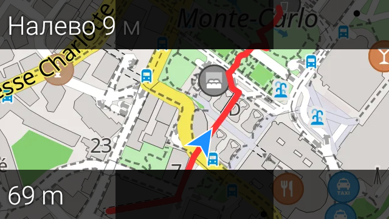
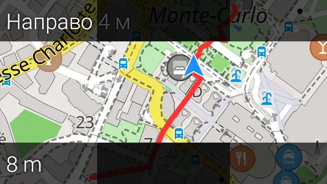
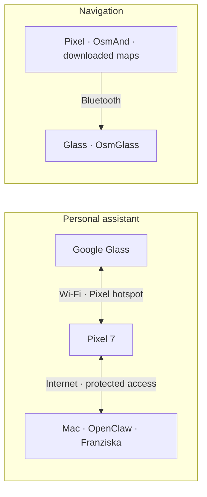

  

# Franziska Glass

**Franziska — a personal AI assistant, brought to Google Glass.**

Google Glass XE24 · Pixel 7 · OpenClaw · Research prototype · November 2026

[About Franziska](docs/FRANZISKA.md) · [Project status](docs/STATUS.md) · [Credits](docs/CREDITS.md) · [Russian translation](README.ru.md)

## Meet Franziska

**Franziska is Ivan Shpak's ongoing personal AI assistant project. Glass is her wearable interface, not the whole project.** The aim is a lasting working relationship with an assistant that can recover previous decisions, help carry projects forward and use connected tools to get practical work done.

Built on OpenClaw and existing AI models, Franziska brings together:

- **A consistent personal identity:** an assistant shaped around one person's working style, preferences and ongoing context.
- **Continuity and memory:** saved notes, project records, conversation archives and retrieval procedures for finding relevant earlier information across sessions and restarts. This is an actively developed system, not a claim of perfect recall.
- **Reasoning and tools:** research, writing, coding, work with local files and authorized actions in connected software, according to the available tools and access.
- **Several ways to interact:** Telegram and the OpenClaw Control UI, with voice and glanceable text on Glass extending the same broader assistant system.

Franziska is not a newly trained foundation model. Her identity, accumulated working context, memory procedures and tool integrations form the personal assistant layer; OpenClaw provides the agent infrastructure and configured models provide language and reasoning capabilities.

**The Glass project asks: how can that existing assistant become useful while your hands and attention are elsewhere?** Voice, short text and camera-related workflows are the wearable direction. Navigation is a separate companion feature, not the definition of Franziska.

[Read the assistant project overview →](docs/FRANZISKA.md)

## Why Google Glass?

Google Glass offered a compelling interaction: useful information alongside the world, rather than another screen replacing it. Ivan Shpak's Franziska Glass project explores that idea with a modern personal assistant, custom Glass and Pixel companion apps, and a separate OsmAnd/OsmGlass navigation integration.

This is an independent research prototype, not a restoration of Google's retired cloud services or a finished commercial product.

## What exists today

- **Voice integration:** recorded sessions include real consultations with the main assistant. Sustained audio quality, long-answer delivery and on-head Stop still need acceptance.
- **Glanceable chat:** a native conversation/status interface is installed on Glass. Optical readability and gestures remain under evaluation.
- **Photos and gallery:** photo/sync components and a native Pixel gallery are installed; the complete capture-to-use workflow is not yet accepted.
- **Mobile connectivity:** the protected Glass–Pixel link and authenticated OpenClaw access over cellular data/VPN were demonstrated. This was a connectivity check, not an outdoor voice conversation.
- **Navigation:** real Glass displayed changing map, turn and distance information over Bluetooth while Pixel was locked, using native route simulation.

## Real hardware, simulated route

  
  

Captured on 30 October 2026. These are device framebuffer screenshots, not mockups, optical-through-the-prism photographs or field GPS evidence. Navigation UI: OsmAnd/OsmGlass. Map: © OpenStreetMap contributors. [Credits](docs/CREDITS.md).

## Two separate paths

**AI assistant:** Glass ↔ Pixel over Wi-Fi/hotspot ↔ internet ↔ a powered, reachable Mac running OpenClaw. Pixel handles connectivity and media; the existing Mac-hosted agent retains memory, conversation and tools. The assistant is not currently Bluetooth-only or Mac-independent.

**Navigation:** Pixel/OsmAnd → Bluetooth → Glass/OsmGlass. Maps and routing live on the phone; no Mac or OpenClaw is required. Fully disconnected journeys, real GPS field use and rerouting still need validation. Live traffic and public transport timetables are not promised.

## Next milestones

Real walks, reliable long conversations, predictable Stop/reconnect, prism readability, thermal and battery observations, and a short live video with clearly stated test conditions.

This showcase contains presentation materials only: no application source, APKs, credentials, personal conversations or raw internal logs. No live video is included yet. Repository access must be set to **Private**; this text does not enforce access control. GitHub Pages is not required.

Independent project, not affiliated with Google. Third-party names belong to their respective owners.
