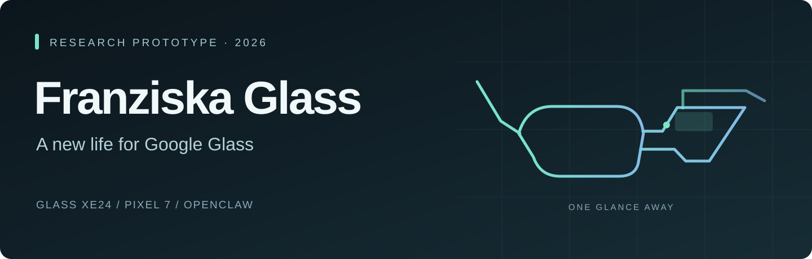
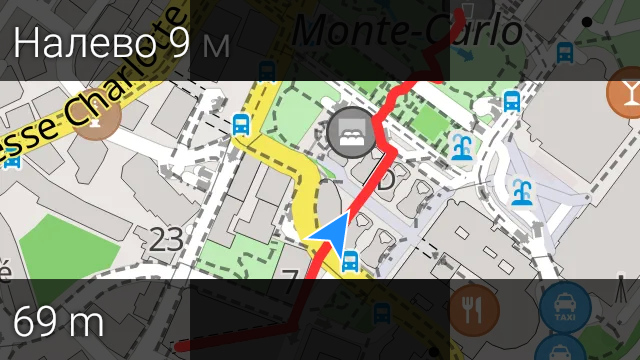
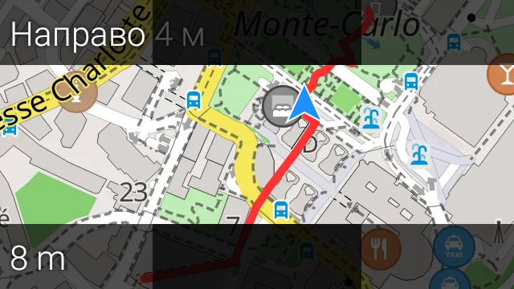
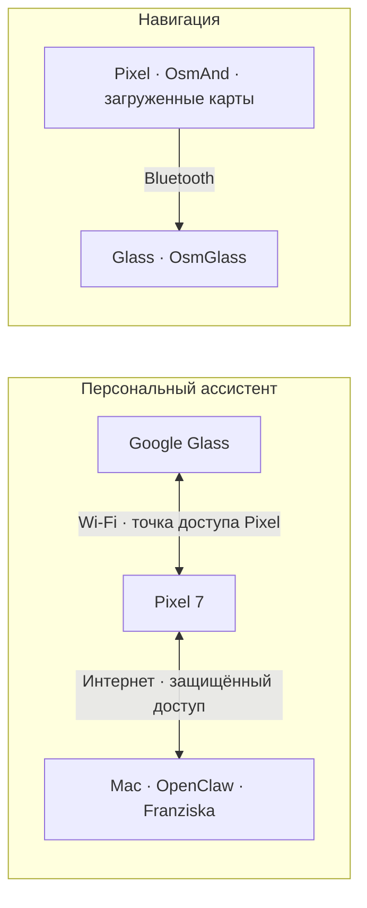

  

  <strong>Персональный AI-ассистент. Короткий взгляд вместо ещё одного экрана.</strong> 
  Google Glass XE24 · Pixel 7 · OpenClaw 
  Исследовательский прототип · Ноябрь 2026

  <a href="README.md">English</a> · Русский · <a href="docs/STATUS.ru.md">Возможности и стадия проекта</a>

---

## Зачем мы это делаем

Google Glass предложили удивительно простую идею: нужная информация появляется рядом с миром, а не вместо него. Мы возвращаемся к этой идее с современным персональным ассистентом — голосом, небольшим экраном и телефоном в кармане.

**Franziska Glass** — авторский проект Ивана Шпака: приложения для очков и Pixel, связка с Franziska/OpenClaw и отдельное направление навигации на основе OsmAnd и OsmGlass. Мы не восстанавливаем старый облачный сервис Google и не выдаём прототип за готовый коммерческий продукт.

## Что уже есть

| Направление | Подтверждённый результат |
| --- | --- |
| **Голосовой ассистент** | Голосовая интеграция реализована; в записанных сеансах были реальные обращения к основному агенту. Устойчивость длительных разговоров ещё проверяется. |
| **Чат в очках** | Установлен собственный интерфейс Glass с текстом разговора и статусом. Читаемость через призму и жесты требуют отдельной проверки. |
| **Фото и галерея** | Установлены компоненты фото/синхронизации и нативная галерея Pixel. Полный пользовательский сценарий ещё не принят. |
| **Связь вне домашнего Wi-Fi** | Проверены защищённая связь Glass с точкой доступа Pixel и авторизация OpenClaw через мобильный интернет/VPN. Это проверка связи, не полноценный разговор на прогулке. |
| **Навигация** | На настоящем экране Glass показаны меняющиеся карта, манёвры и расстояния по Bluetooth при заблокированном Pixel. Демонстрация использовала моделирование маршрута. |

## Настоящий экран Glass

Эти два снимка сделаны **30 октября 2026 года** во время нативного моделирования маршрута в OsmAnd. Между кадрами изменились направление поворота, положение и оставшееся расстояние. Это не нарисованный макет и не запись настоящей GPS-прогулки.

  
  

*Навигационный интерфейс: OsmAnd / OsmGlass. Карта: © OpenStreetMap contributors. [Атрибуция и материалы](docs/CREDITS.ru.md). Снимок framebuffer не доказывает читаемость изображения через призму очков.*

## Как это устроено

У проекта два независимых контура:

**Ассистент:** Glass отвечает за взаимодействие, Pixel — за связь и медиа, доступный Mac с OpenClaw — за основного агента, память, историю и инструменты. Для AI-функций Mac должен оставаться включённым и доступным; носить его с собой не предполагается. Ассистент сейчас не является Bluetooth-only решением.

**Навигация:** телефон рассчитывает маршрут по загруженным картам, очки показывают подсказки. Этот контур не требует Mac или OpenClaw. Полноценная поездка без интернета и полевые GPS-проверки ещё впереди; пробки и расписания транспорта не заявляются.

## Что дальше

- Пройти настоящий маршрут и проверить GPS, подсказки и возврат связи.
- Проверить длительный разговор: полноту ответа, звук и предсказуемый Stop.
- Оценить читаемость через призму, нагрев и время работы.
- Записать короткое живое видео с явно указанными условиями демонстрации.

**Стадия: работающий исследовательский прототип.** Здесь показаны уже полученные результаты, а не обещание готовности всех сценариев. Подробнее — [текущее состояние](docs/STATUS.ru.md).

---

Эта витрина содержит только презентационные материалы — без исходников приложений, APK, ключей, личных разговоров и внутренних журналов. Видео и постановочные фотографии устройства пока не включены. Режим доступа задаётся настройкой репозитория **Private**, а не этим текстом; GitHub Pages не требуется.

Независимый проект; не аффилирован с Google. Названия сторонних продуктов принадлежат их правообладателям.
