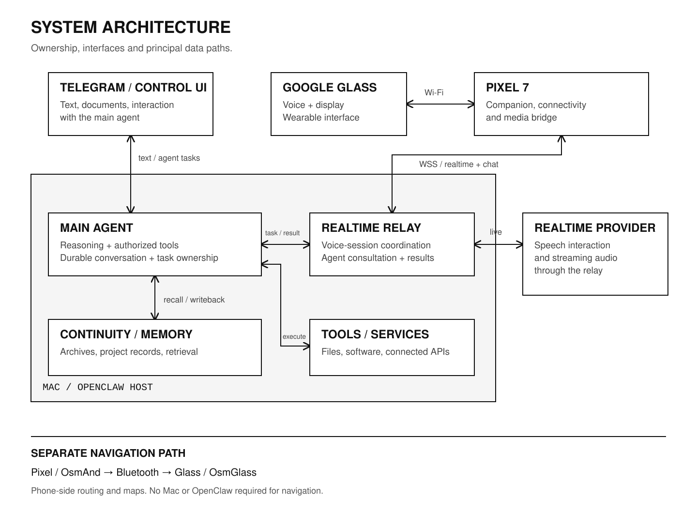

# Franziska / System architecture

[Overview](../README.md) · [The assistant](FRANZISKA.md) · [OpenClaw engineering](OPENCLAW.md) · [Glass & Pixel](WEARABLE.md)

## 1. Ownership before transport

The system separates three concerns: durable agent work, live media and device interaction.

**The Mac is the agent host.** OpenClaw hosts the main-agent runtime, maintains conversations and coordinates tool execution. Inference is supplied by the selected model backend, which can be a provider API or a separately configured local service. The diagram separates that backend from the Mac runtime. Franziska's continuity records and retrieval are available to that agent.

**Pixel is the companion.** It provides the network path and mediates between the Glass application and the Gateway. Its responsibilities include connection preparation, media transport, companion UI and service lifecycle. Tool adapters execute on the agent host or dispatch to separately connected services; those external APIs are not physically inside the Mac.

**Glass is the wearable endpoint.** It captures input, displays the conversation and status, plays audio and exposes wearable controls. Its limited CPU, memory, display and Android environment make the distribution of responsibilities important.

The phone does not acquire an independent copy of the assistant's identity and project history. The architecture retains one durable agent layer while allowing different front ends and voice sessions.

## 2. Text and tool requests

Telegram and the Control UI deliver messages to the OpenClaw conversation. The agent works within that conversation, loads the relevant instructions and context, calls tools and integrates the returned results.

The durable output is more than a screen message. It includes the recorded conversation, the result of the operation and any updated project or continuity records. This allows later work to recover what actually happened rather than infer it from a previous plan.

The configured reasoning model is an inference component. The agent's identity, records, tool connections and task history are separate parts of the system, not properties stored inside a newly trained Franziska model.

## 3. The wearable voice path

The assistant uses the following path:

**Glass ↔ protected Wi-Fi/IP link ↔ Pixel ↔ secure WebSocket ↔ OpenClaw realtime relay ↔ realtime provider.**

At home, Glass and Pixel can use the local network. In the portable configuration, Glass uses Pixel's Wi-Fi hotspot and Pixel uses mobile internet to reach the Gateway. The local pairing and peer authentication remain separate from the upstream Gateway credential.

Realtime speech and tool execution are separate lanes. The live provider handles spoken interaction and audio generation. It consults the main agent when the request needs durable context or a tool-backed action. The consultation reaches the existing agent context through the Gateway rather than constructing a new assistant on the phone.

This distinction also keeps the architecture legible: a direct conversational voice reply and a completed main-agent task are not the same event.

## 4. A tool-backed voice request

1. **Input:** the user speaks through Glass; Pixel bridges the media to the Gateway.
2. **Interpretation:** the realtime layer identifies the request and invokes a main-agent consultation when required.
3. **Context:** the main agent reads the conversation and retrieves relevant continuity or project information.
4. **Execution:** the agent performs the authorized source inspection or tool operation.
5. **Completion:** the task obtains a result; that result must remain associated with its request and conversation.
6. **Return:** the Gateway makes the result available to the voice interaction and device-facing conversation stream.
7. **Output:** Pixel and Glass transport, buffer and play the resulting media, while Glass presents status and text.
8. **Continuity:** the durable conversation and any relevant project records retain the outcome for future work.

Starting an agent run does not finish the task. Receiving the result does not prove playback has drained. Ending a media connection does not, by itself, erase the underlying work. The custom runtime and Android work address these distinct lifecycles.

## A visual question during Talk

This path uses the agent and returns to the existing voice interaction:

1. Pixel checks the backing conversation and its history.
2. The owned image request enters `chat.send` as an `image/jpeg` attachment with its request identity.
3. The client waits for that request's actual final agent result, rather than treating a yielded acknowledgement as the answer.
4. It verifies the result receipt through `chat.history`.
5. It submits the actual answer through `talk.session.sendText` on the current relay, with an instruction to convey it briefly.
6. Session/request guards reject a late result after cancellation; image buffers are cleared on settlement.

This photo caller is distinct from background original-file synchronization and from direct live audio. Its speech instruction is not a universal exact-verbatim contract. Accepted text submission, queued speech and completed playback remain separate events.

## Authority and result delivery

The latest direct user request and correction govern the task. A consultation paraphrase must not silently change that request. The main agent owns evidence and tool-backed results; the realtime layer delivers those results rather than inventing a speculative replacement.

The state sequence is **accepted work → final agent result → speech submission → playback completion**. A yielded acknowledgement is not a final result. An ordinary conversational greeting need not consult the main agent; a substantive tool or memory request does.

## 5. Memory is a separate subsystem

OpenClaw's session state and transcripts preserve conversation execution. Franziska's continuity layer organizes the longer-lived working context: stable preferences, project records, decisions, handoffs and indexes that lead back to sources.

Retrieval selects what to read. The main agent interprets those sources in the current task. Updating memory is another explicit operation: a changed decision or completed task must be reflected in the relevant current record rather than left only in an old transcript.

This design separates historical evidence from present operational state. Old messages remain useful evidence without automatically becoming the current plan.

## 6. Connection, task and playback lifetimes

The system has several independent notions of being active:

| Lifetime | Owner | Why it matters |
| --- | --- | --- |
| Durable conversation | OpenClaw / main agent | Context and recorded work outlive a single media session. |
| Accepted agent task | Agent-coordination layer | Work can continue or complete while a voice connection changes. |
| Live provider session | Realtime layer | Input, speech events and provider callbacks have their own sequence. |
| Glass–Pixel connection | Companion transport | A local radio or network transition must not be mistaken for a new identity. |
| Audio playback | Device audio path | Queues and native writes can continue beyond receipt of the last network frame. |
| Media synchronization | Dedicated sync components | File transfer has its own ownership and must not depend on a running conversation. |

Coordination uses explicit task/session ownership and cancellation rules. The implementation details belong to the [OpenClaw](OPENCLAW.md) and [wearable](WEARABLE.md) chapters.

## Recovery at each layer

| Layer | Actual behavior |
| --- | --- |
| Idle Glass–Pixel link | Endpoint discovery and saved-network recovery can restore the outer local link. |
| Pixel–Gateway active voice client | One owned foreground voice session; link loss cancels it rather than transparently recreating the same session. A deliberate interaction starts another session. |
| Gateway–provider | The upstream provider bridge implements bounded reconnect/resumption and generation checks. |
| Accepted main-agent task | Durable work has its own custody; losing audio and explicitly cancelling the task are different operations. |
| Playback | Queued frames, clear, Stop and normal tail drain have their own owner and revision. |

Talk is a foreground interaction. Loss of focus or connection stops capture. The configured 60-minute Talk ceiling is a software session limit, not a measured battery duration.

## 7. Navigation is independent

**Pixel / OsmAnd → Bluetooth → Glass / OsmGlass.**

The phone owns maps, destination handling, route calculation, progress and rerouting. Glass renders the route information and maneuver guidance. This path is independent of the Mac and the AI conversation. Navigation is tested in use.

The distinction is architectural, not cosmetic: losing the assistant's Gateway connection is a different event from stopping the phone's route or losing the Bluetooth guidance link.

## 8. Operating dependencies

The assistant's AI and tool functions require the configured model services, a reachable Gateway and its running Mac host. Portable operation uses Pixel for the network bridge; the Mac can remain elsewhere. Navigation uses downloaded phone-side map data and the local Bluetooth path.

Software identity, local pairing, upstream authentication and saved application state are preserved as separate concerns during maintenance. Source preparation, application installation and Gateway activation are likewise different operations. The maintenance pipeline reflects that separation.
